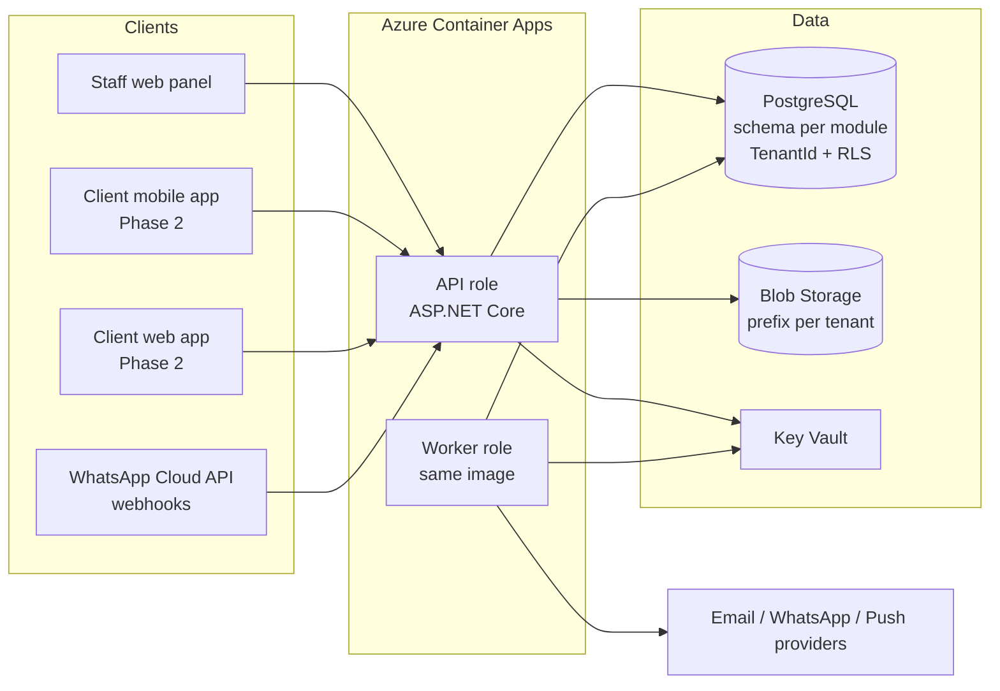

Title: Gym Backend Architecture Options
Author: Rodrigo Tristany
Version: 0.1 (draft for review)
Date: 11-20-2026
Status: Proposed. Based on `BusinessRequirements.md` v3.2 and `NonFunctionalRequirements.md` v0.4.

# Gym Backend: Architecture Options

## 0. Summary

Three options were assessed against the BRD and NFRs:

| | Option A: Modular Monolith | Option B: Microservices | Option C: Serverless |
|---|---|---|---|
| Deployable units | 1 image, 2 roles (API, worker) | 8–9 services + gateway | ~10 Function apps + API gateway |
| Database | 1 PostgreSQL, one schema per module | 1 PostgreSQL database per service | 1 PostgreSQL (or Cosmos DB) |
| API | REST + in-process events + outbox | REST at the edge, gRPC + message bus inside | REST through API Management, Durable Functions for timers |
| Auth | ASP.NET Core Identity + OpenIddict, in process | Dedicated identity service (or Keycloak) | External IdP (Entra External ID) |
| Stage 0 cost (NFR-CO-01: ≤ USD 50) | ≈ USD 25–50 ✅ | ≈ USD 150–300 ❌ | ≈ USD 40–90 ⚠️ |
| Team | 1–3 .NET developers | 6+ developers and a platform engineer | 2–4 developers with Azure Functions experience |
| Complexity | **Medium** | **Very high** | **Medium-high** |

**Recommendation: Option A, a modular monolith** on ASP.NET Core (.NET 10, already the project's stack) and PostgreSQL, deployed as one container image to Azure Container Apps. It is the only option that meets the Stage 0 budget, keeps the booking invariants (capacity, credits, overlaps) in one database transaction, and lets the data layer enforce tenant isolation in one place. Its module boundaries keep a later move to separate services possible if the team or the load ever requires it. See §5.

---

## 1. Architectural drivers

These requirements shape the choice more than any others. Each option is judged against them.

| # | Driver | Source | What it demands from the architecture |
|---|---|---|---|
| D1 | **Tenant isolation** in one shared database | FR-TEN-02, NFR-08, NFR-SE-25..27 | Isolation enforced centrally in the data layer, plus a second line of defence (row-level security), and tests that cover every endpoint. Also applies to files, caches, jobs, logs. |
| D2 | **Atomic booking** | BR-BK-1/2, BR-MEM-2, FR-BK-03, NFR-SC-06 | Capacity, credit consumption, overlap and eligibility (membership, documents, blocked) checked and written **together**. 100 clients racing for the last spots: zero overbooking. |
| D3 | **Durable timers and jobs** | FR-BK-05/06/11, NFR-AV-05, NFR-PF-09/10 | 30-minute waitlist offers, no-show marking, reminders. Persisted, never lost on restart, processed within 60 s. |
| D4 | **Reliable notifications** without blocking the desk | NFR-AV-06, NFR-SC-08, FR-NOT-* | Outbox pattern, retries for 24 h, per-tenant fair queuing and rate limits for WhatsApp/email. |
| D5 | **Low fixed cost** that falls per gym | NFR-CO-01/02 | Stage 0 ≤ USD 50/month for production, Stage 1 ≤ USD 200. |
| D6 | **Portability** | NFR-05, NFR-CO-06 | Containers, PostgreSQL, OpenTelemetry; provider SDKs only behind adapters. |
| D7 | **Small team, fast Phase 1** | BRD §9 | Phase 1 is staff-operated with one tenant and one branch. Delivery speed matters more than independent scaling. |
| D8 | **Stateless horizontal scaling** | NFR-09, NFR-SC-02 | No in-memory sessions, locks or timers; grow by adding instances and resizing the database. |
| D9 | **Audit of every change** in the same transaction | FR-AUD-01, NFR-PF-04 | Before/after values, on whose behalf, written atomically with the change. |

---

## 2. Option A: Modular Monolith

### 2.1 Architecture style

One ASP.NET Core application, split into **modules that follow the business capabilities** of the BRD. Each module owns its data, exposes a small public contract to other modules, and hides everything else. The same container image runs in two roles:

- **API role**: HTTP endpoints for the staff panel (Phase 1) and the client apps (Phase 2), plus webhooks (WhatsApp).
- **Worker role**: outbox dispatch, scheduled jobs (waitlist expiry, no-shows, reminders), notifications.

At Stage 0 both roles can run in **one replica** to save cost; from Stage 1 they run as separate Container Apps so the API can scale independently of the worker.



### 2.2 Project structure and module boundaries

```
GymBackend.sln
src/
  GymBackend.Host/                     # today's GymBackend project: Program.cs, DI, middleware, auth, OpenAPI, role switch (api|worker)
  BuildingBlocks/
    GymBackend.SharedKernel/           # Entity, TenantId, Result, domain events, IClock, IAuditable
    GymBackend.Infrastructure/         # base DbContext, tenant filter + RLS interceptor, audit interceptor,
                                       # outbox/jobs, storage abstraction, notification adapters, OpenTelemetry
  Modules/
    Tenancy/        Tenancy.csproj + Tenancy.Contracts.csproj
    Identity/       ...
    Organization/
    Catalog/
    Scheduling/
    Booking/
    Coaching/
    Documents/
    Billing/
    Notifications/
    Audit/
tests/
  GymBackend.ArchitectureTests/        # module dependency rules, "every endpoint has a policy", "every tenant table has a filter"
  GymBackend.IntegrationTests/         # Testcontainers PostgreSQL; tenant-isolation suite (NFR-SE-27); booking race tests (NFR-SC-06)
  Modules/<Module>.Tests/              # domain unit tests
```

Inside a module, code is organised by **feature** (vertical slices: `Bookings/CreateBooking`, `Waitlist/AcceptOffer`) with `Domain`, `Persistence` and `Endpoints` folders. Only the `.Contracts` project is visible to other modules: query interfaces, commands, and integration events.

| Module | Owns (BRD) | Main contracts used by others |
|---|---|---|
| **Tenancy** | Tenants, suspension, support access grants, offboarding export (§4.0) | `ITenantStatus` (is suspended?), `TenantSuspended` event |
| **Identity** | Accounts (platform-wide), passwords, 2FA, social login, refresh tokens, invitations, gym switching (§4.1, FR-TEN-09/10) | `IAccountDirectory`, `AccountLinkedToGym` event |
| **Organization** | Branches, rooms, gym profiles, roles and permissions, settings (§4.2, §4.3, §6) | `IPermissionService`, `ISettings`, `IGymProfiles` |
| **Catalog** | Exercises, routines and routine versions (§4.4, §4.5) | `IRoutineVersions`, `RoutineVersionPublished` event |
| **Scheduling** | Class types, sessions, recurring series, transfer (§4.6) | `ISessionSchedule`, `SessionCancelled` / `SessionRescheduled` / `CapacityReduced` events |
| **Booking** | Bookings, waitlist, offers, check-in, no-shows, cancellation counter (§4.7) | `BookingCreated` / `BookingCancelled` / `NoShowRecorded` events |
| **Coaching** | Professor assignments, exercise plans, progress logs (§4.8–4.10) | — |
| **Documents** | Medical certificates, waiver, liability contract, guardian consent, signing links (§4.11) | `IDocumentStatus` (can book? has liability contract?) |
| **Billing** | Tiers, memberships, credits, payments, voids, financial export (§4.12, §4.13) | `IMembershipEligibility`, `ICreditLedger` |
| **Notifications** | Templates, channels, per-tenant senders, outbox delivery, retries, rate limits (§4.14, FR-TEN-05) | `INotificationSender` (enqueue only) |
| **Audit** | Tenant and platform audit logs, retention (§4.15) | written by an interceptor, read by Admin only |

**Rules enforced by architecture tests:** a module references only other modules' `.Contracts`; no module reads another module's tables; cross-module writes happen through contracts. The one deliberate exception is that contracts **may join the caller's database transaction** (see D2 below), which is the main reason to choose a monolith.

### 2.3 Database and schema approach

**PostgreSQL** (Azure Database for PostgreSQL Flexible Server), one database, **one schema per module** (`identity`, `booking`, `billing`…), one EF Core `DbContext` per module.

| Concern | Approach |
|---|---|
| Tenant isolation (D1) | Every tenant-owned table has `tenant_id uuid not null`. **Layer 1:** EF Core global query filters on every tenant entity, plus a `SaveChanges` interceptor that stamps and checks `tenant_id` on writes. **Layer 2:** PostgreSQL **row-level security** with `FORCE ROW LEVEL SECURITY`; the app connects as a non-owner role, and a connection interceptor runs `set_config('app.tenant_id', …, true)` at the start of each transaction (transaction-local, so connection pooling is safe). Platform-only code uses a separate role with `BYPASSRLS`, in a reviewed namespace. |
| Shared (non-tenant) tables | `identity.accounts`, `identity.external_logins`, `identity.refresh_tokens`, `tenancy.tenants`, platform audit. Everything a gym knows about a person lives in `organization.gym_profiles` (tenant-owned, `account_id` nullable, so Phase 1 clients have no account). |
| Indexes | Every index on a tenant table starts with `tenant_id` (NFR-PF-02). Uniqueness rules are per tenant: `unique (tenant_id, lower(name))` (BR-GEN-5, BR-EX-1). |
| Identifiers | `uuid` primary keys (NFR-SE-28). UUIDv7 (`Guid.CreateVersion7()`) is index-friendly and not guessable, but leaks the creation time; confirm that is acceptable, otherwise use random v4 for public IDs. |
| Atomic booking (D2) | `class_sessions.booked_count` with `check (booked_count <= capacity)`; booking does a conditional `UPDATE … SET booked_count = booked_count + 1 WHERE id = @id AND booked_count < capacity`. In the **same transaction**: Billing's `ICreditLedger.Consume()` decrements credits with a similar conditional update, and the booking row is inserted. One commit, no saga. |
| Overlap rules | PostgreSQL **exclusion constraints** (`btree_gist`): `EXCLUDE USING gist (tenant_id WITH =, room_id WITH =, tstzrange(starts_at, ends_at) WITH &&) WHERE (status <> 'cancelled')`, the same for `professor_id` (BR-CL-2), and for a client's active bookings (BR-BK-1). The database rejects overlaps even under races. |
| Audit (D9) | An EF interceptor writes `audit.entries` (who, on whose behalf, before/after as `jsonb`) in the same transaction. The table is **partitioned by month**, so the 4-month purge is `DROP PARTITION` (FR-AUD-02). Payment and membership changes go to a separate long-retention table if NFR-SE-23 (10 years) is confirmed. |
| Soft delete | `archived_at` column with a global filter (BR-GEN-1); payments are voided, never deleted (BR-FIN-1). |
| Sensitive fields | National ID numbers and dates of birth encrypted in the application with an EF value converter (envelope encryption, key in Key Vault) (NFR-SE-15). If staff must search by ID number, store an HMAC "blind index" beside it. |
| Migrations | EF Core migrations per module, packaged as a **migration bundle** and run as a pre-deployment job. Expand/contract only, so the previous version keeps working (NFR-AV-04). |
| Per-tenant restore (NFR-AV-11) | Restore the PITR copy to a temporary server, then copy one tenant's rows back with a script driven by `tenant_id`. Possible because every row carries it. |

### 2.4 API design approach

- **REST + JSON** over HTTPS, documented with OpenAPI (already referenced by the project), versioned in the path (`/api/v1/...`). ASP.NET Core Minimal APIs grouped per module.
- **Tenant comes from the access token, never from the URL or a header.** A token issued for gym A is rejected for gym B (NFR-SE-02); IDs from another tenant return `404` (FR-TEN-02 AC).
- **Screen-shaped read endpoints** for the panel and apps (e.g. `GET /api/v1/schedule/week?branchId=…` returns sessions, room, professor and the caller's booking state), so each screen needs one request (NFR-PF-16). Lists are paginated (default 20, max 100), responses compressed.
- **Commands as resources**: `POST /bookings`, `POST /bookings/{id}/cancel`, `POST /waitlist-offers/{id}/accept`, `POST /check-ins`. Idempotency keys on booking and payment writes, so mobile retries never double-book.
- **Webhooks**: `POST /webhooks/whatsapp` verifies Meta's `X-Hub-Signature-256`, stores the message in an **inbox** table and returns `200` immediately; the worker processes it idempotently.
- **Public token endpoints** for Phase 1 clients without an account: `GET/POST /links/{token}` for signing and offer acceptance (NFR-SE-34), and an iCal feed `/calendar/{secret}.ics` (FR-BK-12).
- **Events inside the process**: domain events are written to an **outbox table** in the same transaction and dispatched by the worker to in-process handlers (e.g. `BookingCancelled` → Booking promotes the waitlist → Notifications sends the offer). This gives reliability without a message broker.
- **Not used**: GraphQL (three first-party clients with known screens; it would complicate per-field authorization for NFR-SE-10), gRPC (no internal network calls).

### 2.5 Authentication and authorization

**Authentication: ASP.NET Core Identity + OpenIddict, inside the Identity module.**

- Identity stores accounts, PBKDF2/Argon2id hashes, lockout, TOTP and recovery codes (NFR-SE-03..05). OpenIddict issues **15-minute JWT access tokens** and **rotating refresh tokens** with reuse detection (NFR-SE-02). Google and Apple are added as external providers in Phase 2.
- **Gym selection**: after sign-in the token carries `sub` (account), `tenant_id`, `profile_id` and `branch_ids`. Switching gym exchanges the refresh token for a new access token scoped to the other gym, without signing in again (FR-TEN-09). Suspended tenants are refused at token issuance and on refresh (FR-TEN-06).
- **2FA enforcement**: a token without the `amr=mfa` claim is accepted only by the "enrol 2FA" endpoints when the account holds a staff role in any gym (FR-AUTH-03 AC).
- **Impersonation**: a separate 30-minute token with an `act` claim for the Admin; every response carries an `X-Impersonating` header and the audit interceptor records both identities (NFR-SE-07).
- **Support access**: a Platform admin token only reaches tenant data when a valid, time-limited grant exists for that tenant (FR-TEN-07, NFR-SE-29).
- Web apps keep the refresh token in an HttpOnly, Secure, SameSite cookie; mobile in the secure keystore.

Running the token server in process costs nothing and gives full control over the gym-switch flow, which external identity providers support only through custom extensions. It sits behind the Identity module, so it can later be replaced by an external provider.

**Authorization: permission-based RBAC with resource handlers.**

- Permissions are constants (`bookings.create`, `payments.void`, `documents.medical.read`…). Built-in roles are seeded per tenant and locked; custom roles are sets of permissions (FR-ROLE-01..03).
- Permissions are **not** put in the token. They are loaded per request from a short-lived cache keyed by `tenant:profile:permissionsVersion`, so a role change applies immediately and tokens stay small.
- Endpoints declare a **permission policy** (default deny; an architecture test fails the build for an endpoint without one, NFR-SE-11). "Own" and "assigned" rules are **resource-based authorization handlers** (`IsOwner`, `IsAssignedProfessor`) run against the loaded record (NFR-SE-09).
- Field-level rules (Accountant sees name/contact only, medical certificates for Admin/Receptionist/assigned professors only) use **separate response models per audience** (NFR-SE-10).
- Phase 1 clients have no token: their only identity is the single-use link token or the phone number the WhatsApp offer was sent to (NFR-SE-34).

### 2.6 Deployment model

| Item | Choice |
|---|---|
| Compute | **Azure Container Apps**, one image. Stage 0: 1 replica running API + worker. Stage 1+: API app (≥ 2 replicas, HTTP autoscale) and worker app (1–2 replicas, always on). |
| Database | Azure Database for PostgreSQL Flexible Server (B1ms → B2s → D2ds per NFR §5.1), PITR 30 days, built-in PgBouncer from Stage 1. |
| Files | Azure Blob Storage behind `IFileStorage`, private containers, one prefix per tenant, pre-signed URLs ≤ 5 min (NFR-SE-16). CDN for exercise media from Stage 1. |
| Jobs & outbox | PostgreSQL tables polled with `FOR UPDATE SKIP LOCKED`, round-robin across tenants for fairness (NFR-SC-11). Either a thin in-house implementation or a library with PostgreSQL persistence (e.g. Wolverine, Hangfire). Decide with a short spike (§6). |
| Secrets | Key Vault, accessed with managed identity. |
| Observability | OpenTelemetry → Application Insights; every log and trace tagged with `tenant_id` (NFR-SE-26). External uptime probe on `/health/ready` (NFR-AV-01). |
| CI/CD | GitHub Actions: build, tests (including Testcontainers isolation suite), image scan, push to registry, run migration bundle, rolling revision update (zero downtime, NFR-AV-04). |
| Local | `compose.yaml` with PostgreSQL, Azurite (blob), and a mail catcher. |
| Rate limits | ASP.NET Core rate limiter partitioned by tenant. In memory per replica at Stage 0–1 (limit divided by replica count); a shared store (Redis) only if exact limits are needed at Stage 2. |

### 2.7 Assessment

**Pros**

- Booking, credits, overlaps and audit commit in **one ACID transaction**, so D2 and D9 are simple and provably correct.
- Tenant isolation lives in **one** data-access layer and one database, with RLS as a backstop; the isolation test suite covers every endpoint in one test run.
- Cheapest option: fits Stage 0 (≈ USD 25–50) and Stage 1 (≈ USD 110–200) as estimated in NFR §5.1.
- One build, one deployment, one database to migrate and back up; easy local development and debugging.
- Uses the project's existing stack (ASP.NET Core .NET 10, Docker, NUnit) with no new platforms to learn.
- Module contracts and schema-per-module keep the door open to extracting a service later.

**Cons**

- Boundaries are kept by discipline and architecture tests, not by the network; without those tests the code can erode into a "big ball of mud".
- All modules scale together, and a memory leak or a heavy export can affect the whole API (mitigated by running exports in the worker).
- One deployment cadence for all modules; fine for one team, limiting for several.
- The in-process token server (OpenIddict) is security-critical code the team must keep up to date.

**NFRs**

| Satisfies | Trades off / at risk |
|---|---|
| AV-01..05 (one replica restart ≈ 1–2 min at Stage 0 is within budget; durable jobs in PostgreSQL), AV-07..11, PF-01..13, SC-01..10, SC-06 (conditional update + exclusion constraints), SE-25..34, SE-02..11, CO-01..09 (fits every budget), CO-06 portability (containers + PostgreSQL + OTel) | **SC-11 noisy neighbour** is softer: tenants share process resources, so per-tenant limits and fair queuing must be built deliberately. **AV-01 at Stage 0**: a single replica has no redundancy (accepted in NFR §5.1). **SC-02**: fine up to Stage 2, but independent scaling of a single hot module is not possible. |

**Team and expertise:** 1–3 developers. At least one senior .NET developer comfortable with EF Core, PostgreSQL (RLS, exclusion constraints, transactions) and ASP.NET Core security. No dedicated DevOps role needed.

**Estimated complexity: Medium.** The hard parts (tenant isolation, booking concurrency, durable jobs) exist in every option; here they are solved with database features rather than distributed-systems patterns.

---

## 3. Option B: Microservices

### 3.1 Architecture style

Independent services, each with its own database and deployment, communicating through a **message bus** (asynchronous events) and **gRPC** (synchronous queries). An API gateway handles routing, token validation and rate limiting.

### 3.2 Service boundaries

| Service | Responsibilities | Notes |
|---|---|---|
| **Gateway** (YARP or Azure API Management) | Routing, JWT validation, per-tenant rate limits, CORS | Single public entry point |
| **Identity & Tenancy** | Accounts, tokens, invitations, tenants, suspension, support access | Could be replaced by Keycloak |
| **Organization** | Branches, rooms, gym profiles, roles/permissions, settings | Read by almost every service |
| **Catalog** | Exercises, routines, versions | |
| **Scheduling & Booking** | Class types, sessions, bookings, waitlist, check-in | **Must stay one service**: capacity and overlap checks need the session data in the same transaction |
| **Coaching** | Assignments, plans, progress logs | |
| **Documents** | Documents, signing links, file storage | |
| **Billing** | Tiers, memberships, credits, payments, export | |
| **Notifications** | Email, WhatsApp, push, webhooks | Consumes events from all services |
| **Audit** | Consumes change events, stores tenant/platform audit | Audit is no longer in the same transaction as the change |

Solution: one repository per service (or a monorepo with one solution per service), shared NuGet packages for tenancy, auth and messaging building blocks.

### 3.3 Database and schema approach

- **Database per service** (separate databases on one PostgreSQL server at first to save cost, separate servers later). Each still uses `tenant_id` + global filters + RLS, which now has to be implemented and tested **in every service**.
- Cross-service data is replicated through events into local read models (e.g. Booking keeps a copy of membership status and document status).
- **Booking with credits becomes a saga**: Booking reserves a spot → asks Billing to consume a credit → confirms or compensates. Between steps the system is inconsistent, and eligibility checks against replicated data can be seconds out of date (a client blocked a moment ago may still book).
- Audit is written from events (eventually consistent), which weakens FR-AUD-01's "same transaction" expectation (NFR-PF-04).

### 3.4 API design approach

- **REST** at the gateway for the apps; possibly a **BFF** (backend for frontend) per app to compose screens from several services (NFR-PF-16).
- **gRPC** between services for synchronous queries (eligibility, permissions).
- **Events** on **Azure Service Bus** (topics per event type), with an outbox in every service, idempotent consumers and dead-letter handling.

### 3.5 Authentication and authorization

- Identity service (OpenIddict) or **Keycloak** as a dedicated container issues tokens; the gateway validates them, and each service validates again (zero trust).
- Permissions must be available everywhere: either embedded in the token (large tokens, stale until refresh) or fetched from the Organization service per request (extra network hop on every call, cached).
- Service-to-service calls use managed identities or mTLS.

### 3.6 Deployment model

- **Azure Kubernetes Service** or **Azure Container Apps with Dapr** (service invocation, pub/sub, state). 9–10 always-on apps, Service Bus Standard, one or more PostgreSQL servers.
- Distributed tracing is mandatory to debug a booking that spans 3–4 services.
- Contract tests between services, versioned events, independent pipelines.

### 3.7 Assessment

**Pros**

- Services can be scaled, deployed and failed **independently** (e.g. Notifications bursts don't affect booking latency).
- Clear ownership boundaries for several teams.
- Technology freedom per service.

**Cons**

- **Breaks the cost budget**: at least 9 always-on containers (≈ USD 10–20 each), Service Bus, gateway and larger database ≈ USD 150–300/month at Stage 0, against a ≤ USD 50 target.
- The core business invariant (D2) is split across services: sagas, compensations and eventual consistency replace a single transaction.
- Tenant isolation must be re-implemented and tested in **every** service and every message consumer; more places for a leak (NFR-SE-26).
- Per-tenant restore (NFR-AV-11) must coordinate several databases to the same point in time.
- Much higher operational load: tracing, versioned contracts, message replay, partial outages.
- Slow Phase 1 delivery for a small team.

**NFRs**

| Satisfies | Trades off / at risk |
|---|---|
| SC-02 / SC-11 strongly (independent scaling, fault isolation), SC-08 (notifications isolated), AV-06, CO-06 (containers) | **CO-01/02** (budget exceeded at Stage 0 and likely Stage 1), **SC-06 / BR-BK-2 / BR-MEM-2** (credit + spot across services needs a saga), **FR-AUD-01 / PF-04** (audit not in the same transaction), **PF-03** (extra network hops in booking), **AV-11** (multi-database restore), **SE-25..27** (isolation duplicated N times), **AV-01** (more moving parts: availability is the product of each dependency's availability) |

**Team and expertise:** 6+ developers organised in 2–3 teams, plus a platform/DevOps engineer. Experience with distributed systems, messaging, sagas, Kubernetes or Dapr, and observability.

**Estimated complexity: Very high.** Justified when several teams need to ship independently or modules have very different scaling needs; neither is true at Stage 0–2 (≤ 500 req/s, NFR-SC-03).

---

## 4. Option C: Serverless (Azure Functions)

### 4.1 Architecture style

Business capabilities implemented as **Azure Functions** (.NET isolated worker) triggered by HTTP, timers, queues and webhooks, with **Durable Functions** for long-running workflows. **Azure API Management** (Consumption tier) is the gateway. The platform scales to near zero when idle.

### 4.2 Project structure and boundaries

One Function app per capability (same boundaries as the modules in §2.2), sharing class libraries for domain, tenancy and persistence:

```
src/
  Shared/   GymBackend.Domain, GymBackend.Persistence (EF Core + tenant filters), GymBackend.Tenancy
  Functions/
    Identity.Functions        # HTTP: sign-in, refresh, invitations (or delegated to an external IdP)
    Scheduling.Functions      # HTTP: sessions, series
    Booking.Functions         # HTTP: book/cancel; Durable orchestration: waitlist offer with a 30-min durable timer
    Documents.Functions       # HTTP + Blob trigger (upload completed)
    Billing.Functions         # HTTP + timer (overdue checks)
    Notifications.Functions   # Queue trigger: send email/WhatsApp/push with retries
    Webhooks.Functions        # HTTP: WhatsApp webhook
    Jobs.Functions            # Timer: no-shows, reminders, audit purge
```

### 4.3 Database and schema approach

- **PostgreSQL** (same schema approach as Option A: `tenant_id`, RLS, exclusion constraints, conditional updates), so booking keeps its single transaction **if** Booking and Billing code run in the same function.
- Alternative: **Cosmos DB serverless** with `tenantId` as partition key. Natural tenant partitioning, but transactions are limited to one partition, there are no exclusion constraints or joins, and the financial export and reporting become harder. Not recommended.
- Serverless scale-out can open many database connections at once: use the built-in PgBouncer and cap function concurrency.

### 4.4 API design approach

- **REST** through API Management (routing, JWT validation, per-tenant rate limits via policies).
- **Events** on Storage Queues or Service Bus between function apps; Durable Functions for waitlist offers (`CreateTimer` for the 30-minute window, external event for acceptance) and recurring series.

### 4.5 Authentication and authorization

- An **external identity provider** (Microsoft Entra External ID; free up to 50,000 monthly active users) handles sign-in, 2FA and social login. The gym-switch flow and the per-gym token (NFR-SE-02) need a **custom claims extension** (an HTTP callback during token issuance) that adds `tenant_id`; switching gym means requesting a new token with a different parameter.
- API Management validates the JWT; each function checks permissions with a shared library and loads them from the database.
- Phase 1 links and WhatsApp replies handled as in Option A.

### 4.6 Deployment model

- Azure Functions **Flex Consumption** with "always ready" instances for the booking and sign-in apps (to avoid cold starts), API Management Consumption, PostgreSQL Flexible Server, Storage, Key Vault, Application Insights. Infrastructure as code (Bicep).

### 4.7 Assessment

**Pros**

- Pay per use: almost no cost when idle, automatic scaling for peaks.
- Built-in triggers and **Durable Functions** fit the timers well (waitlist offers, expiry, reminders).
- Low infrastructure management: no containers or replicas to size.

**Cons**

- **Lock-in to Azure**: function triggers, Durable Functions and APIM policies don't move to another provider, breaking NFR-05 and NFR-CO-06.
- **Cold starts** threaten p95/p99 targets unless always-ready instances are paid for, which removes most of the cost advantage.
- Local development and testing are harder (Functions host, Durable emulator, APIM not available locally); the `compose.yaml` workflow no longer covers everything.
- Logic spread across many small functions and triggers is harder to follow and test end to end; the tenant context must be restored in every trigger type (HTTP, queue, timer, durable activity).
- Connection management to PostgreSQL under bursty scale-out.
- Gym-switch tokens through an external IdP's extension points add a second, less controllable place for security logic.

**NFRs**

| Satisfies | Trades off / at risk |
|---|---|
| AV-05 / PF-09 / PF-10 (durable timers), SC-02 / SC-08 (automatic scale-out), AV-06 (queue retries), CO-03 (fully managed) | **NFR-05 / CO-06 portability** (not met), **PF-01..05 p95/p99** under cold starts, **CO-01** (≈ USD 40–90 at Stage 0 once always-ready instances and APIM calls are counted: borderline), **SC-11** (per-tenant fairness across queue triggers needs custom work), **SE-26** (tenant context in every trigger type), **AV-04** (zero-downtime is easy, but slot swaps and Durable orchestration versioning add care) |

**Team and expertise:** 2–4 developers with solid Azure Functions, Durable Functions, APIM and Entra External ID experience.

**Estimated complexity: Medium-high.** Less infrastructure work than Option B, but more platform-specific knowledge than Option A and a harder testing story.

---

## 5. Comparison and recommendation

### 5.1 NFR comparison

✅ met comfortably · ⚠️ met with extra effort or cost · ❌ not met or at high risk

| Requirement | A: Modular monolith | B: Microservices | C: Serverless |
|---|---|---|---|
| NFR-CO-01 budget (Stage 0 ≤ USD 50) | ✅ | ❌ | ⚠️ |
| NFR-CO-06 / NFR-05 portability | ✅ | ✅ | ❌ |
| NFR-SC-06 / BR-BK-2 atomic booking + credits | ✅ one transaction | ⚠️ saga | ✅ if co-located |
| NFR-SE-25..27 tenant isolation | ✅ one layer, one test suite | ⚠️ per service | ⚠️ per trigger type |
| FR-AUD-01 / NFR-PF-04 audit in the same transaction | ✅ | ❌ eventual | ✅ |
| NFR-AV-05 durable jobs / PF-09..10 timers | ✅ DB-backed jobs | ✅ bus + scheduler | ✅ Durable Functions |
| NFR-PF-01..05 latency | ✅ | ⚠️ network hops | ⚠️ cold starts |
| NFR-AV-01 99.5 % | ✅ | ⚠️ many dependencies | ✅ |
| NFR-AV-04 zero-downtime deployments | ✅ | ✅ | ✅ |
| NFR-AV-11 per-tenant restore | ✅ | ⚠️ multi-DB | ✅ |
| NFR-SC-02 scale by instances + DB size | ✅ | ✅ | ✅ |
| NFR-SC-11 noisy-neighbour protection | ⚠️ must be built | ✅ | ⚠️ |
| NFR-SC-10 onboarding is configuration only | ✅ | ✅ | ✅ |
| Phase 1 time to market (BRD §9) | ✅ | ❌ | ⚠️ |

### 5.2 Recommendation: Option A, Modular Monolith

1. **It protects the invariants the business cares most about.** Overbooking, double credit use, overlapping sessions and cross-tenant leaks are the costliest failures in the BRD. Option A handles them with database transactions, exclusion constraints and row-level security, which are simpler and more reliable than the distributed equivalents.
2. **It is the only option within budget at every stage** (NFR-CO-01/02), and it keeps cost per gym falling as gyms are added.
3. **It matches the load.** Stage 2 is ≈ 500 req/s and ≈ 15,000 clients (NFR-SC-03). A few container replicas and one PostgreSQL server handle that comfortably; microservices solve a scaling problem this platform will not have for years.
4. **It matches the team and Phase 1.** One developer or a small team can ship the staff-operated MVP quickly on the stack already set up in this repository.
5. **It keeps options open.** Module contracts, one schema per module, `tenant_id` on every row and an outbox mean a module can later become a service (Notifications is the most likely first candidate), and a large gym can move to its own database (NFR §5.2) without rewriting the application.

**What to watch:** module boundaries (enforced by architecture tests from day one) and noisy-neighbour protection (per-tenant rate limits and fair job queuing built into the Infrastructure building block, NFR-SC-11).

**When to revisit:** extract a module into its own service only if one of these is true for a sustained period: more than ~3 teams need independent releases; one module needs very different scaling (e.g. notification volume dominates worker capacity); or a stage-upgrade trigger (NFR-CO-09) cannot be solved by resizing.

---

## 6. Decisions to record next (ADRs)

| # | Decision | Recommended |
|---|---|---|
| ADR-01 | Architecture style | Modular monolith (this document) |
| ADR-02 | Database engine | PostgreSQL (closes NFR §6 item 8) |
| ADR-03 | Tenant isolation mechanism | EF Core global filters + PostgreSQL RLS with transaction-local `app.tenant_id` |
| ADR-04 | Public identifier format | UUIDv7 vs. UUIDv4 (check against NFR-SE-28) |
| ADR-05 | Token server | ASP.NET Core Identity + OpenIddict, in process |
| ADR-06 | Jobs and outbox | In-house PostgreSQL tables vs. Wolverine vs. Hangfire: a 2-day spike, judged on per-tenant fairness, tenant context restore and scheduled-job support |
| ADR-07 | Module communication | Contracts in process; outbox + in-process handlers for events; shared transaction allowed only through contracts |
| ADR-08 | Hosting | Azure Container Apps + PostgreSQL Flexible Server in Brazil South (depends on NFR §6 item 4) |
| ADR-09 | Email and push providers | Azure Communication Services (email), FCM/APNs (push, Phase 2) |
